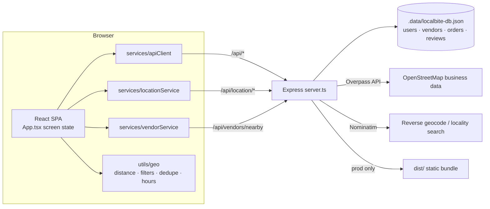

# LocalBite 🍛

**Discover. Order. Enjoy Local Food.**

LocalBite is a location-based discovery and ordering platform for neighbourhood food businesses — chai stalls, poha counters, tiffin kitchens, bakeries and small restaurants that usually never make it onto mainstream delivery apps. It starts with Jagatpura, Jaipur, and is built to work anywhere in India.

The map and the directory are backed by real **OpenStreetMap** data, verified partners get a digital menu with live ordering, and every listing is clearly labelled by trust level so nothing on screen is a fake shop pretending to be real.

---

## Table of contents

- [Why this exists](#why-this-exists)
- [Features](#features)
- [Tech stack](#tech-stack)
- [Architecture](#architecture)
- [Getting started](#getting-started)
- [Environment variables](#environment-variables)
- [Scripts](#scripts)
- [API reference](#api-reference)
- [Project structure](#project-structure)
- [Trust model](#trust-model)
- [Data sources & attribution](#data-sources--attribution)
- [Testing](#testing)
- [Deployment notes](#deployment-notes)
- [Known limitations](#known-limitations)
- [Roadmap](#roadmap)
- [Contributing](#contributing)
- [License](#license)

---

## Why this exists

Food delivery apps optimise for chains and high-volume kitchens. The best plate of poha in a Jaipur colony is usually sold by someone who has no app, no website and no digital menu — and students, hostel residents and office workers have no reliable way to find them, see prices, or place an order ahead of time.

LocalBite sits between two realities:

1. **A free, open directory** of nearby food places sourced from OpenStreetMap, so discovery works on day one with zero vendors signed up.
2. **A verified partner layer**, where a shop owner claims a listing, publishes a menu and receives orders — turning a map pin into a real storefront.

See [ABOUT.md](./ABOUT.md) for the longer product story, design principles and trust/safety model.

---

## Features

### Customer experience

- **Splash → onboarding → location** flow with real device GPS (with graceful denial/unavailable/manual-search fallbacks).
- **Nearby discovery** — verified LocalBite shops merged with live OSM directory listings, de-duplicated and sorted by distance.
- **Map view** (Leaflet + OpenStreetMap tiles) with search-radius ring, an approximate-location privacy circle instead of an exact home pin, and colour-coded markers per trust level.
- **Search & filters** — free text across shop name, owner, category, locality and dish names, plus open-now, "has an orderable menu", max price and minimum rating.
- **Vendor profile → digital menu → cart → checkout → order confirmation → live order tracking** for verified partners.
- **Promo codes** from vendor offers (validated again server-side on checkout, never trusted from the client).
- **Meal plans / tiffin subscriptions** — weekly student passes and monthly tiffin plans surfaced by distance.
- **My orders + genuine reviews** — a review can only be left against your own order, once.
- **Demo Sandbox mode** — two clearly labelled `[DEMO RECORD]` vendors so menus, cart, checkout and tracking can be evaluated without a real verified shop nearby. Demo orders are simulated in the browser and never written to the database.

### Vendor portal

- Register a shop (or claim an OSM listing), which is always created as `pending_verification` — never auto-verified.
- Owner dashboard: publish/edit menu items, toggle availability and "today's special", change prices, add offers and meal plans, and move incoming orders through `accepted → preparing → ready → out_for_delivery → completed`.
- Privacy switches: choose whether owner name and phone number are shown publicly.

### Admin (verifier) portal

- Operator-controlled admin setup: a fixed `ADMIN_PASSCODE`, or a one-time claim protected by server-only `ADMIN_BOOTSTRAP_TOKEN`.
- Review pending vendor applications and mark them **verified** or **rejected** with a reason.

### Safety & privacy details baked in

- Owner name and phone are only exposed when the vendor opts in.
- Public vendor payloads recompute rating/review counts from stored reviews instead of trusting stored aggregates.
- Only `https:`/`http:`/root-relative photo URLs are accepted (no `javascript:` or `data:` URLs).
- Map popups and marker labels are HTML-escaped before insertion into Leaflet.
- Passwords are salted and hashed with `scrypt`; comparisons use `timingSafeEqual`.
- The JSON database path is validated to stay inside the data directory.

---

## Tech stack

| Layer | Choice |
| --- | --- |
| UI | React 19, TypeScript, Tailwind CSS v4 |
| Animation | `motion` |
| Icons | `lucide-react` |
| Maps | Leaflet + OpenStreetMap raster tiles |
| Server | Express 4 + Vite middleware (single process, dev and prod) |
| Storage | JSON file at `.data/localbite-db.json` |
| Auth | HMAC-signed bearer tokens (7-day expiry), `scrypt` password hashes |
| Geo data | OpenStreetMap — Overpass API (business search) + Nominatim (reverse geocode, locality search) |
| Runtime | Node 20+ (developed on Node 22), `tsx` for TypeScript execution |

There is no external database, no ORM and no third-party auth provider: the project is intentionally self-contained so it can be cloned and run in one command.

---

## Architecture



**Key flow — nearby discovery**

1. The client gets GPS coordinates and calls `GET /api/vendors/nearby?lat&lng&radius`.
2. The server enriches verified DB vendors (distance, open status from structured hours, live rating), then fetches OSM listings from Overpass (with a Nominatim fallback), caches the merged bucket for 2 minutes, and returns both.
3. The client merges in Demo Sandbox records if enabled, then applies local search/filter logic in `src/utils/geo.ts`.

**Key flow — ordering**

1. Cart is client-side and always single-vendor (adding from another shop resets the cart).
2. `POST /api/orders` re-validates everything: the vendor must be verified, each item must exist and be available, quantities are clamped 1–25, prices are taken from the database (not the request), and the promo discount is recomputed server-side.
3. Vendors update status via `PATCH /api/vendor/orders/:orderId/status` with an ownership check.

---

## Getting started

### Prerequisites

- Node.js **22.18+ recommended** (verified on 22.22). `npm run dev` works on Node 20 via `tsx`, but `npm start` executes TypeScript directly and therefore relies on Node's built-in type stripping, which is only on by default from 22.18.
- npm or bun
- A browser with geolocation, and internet access for OSM tiles / directory data

### Install and run

```bash
git clone https://github.com/ujjwalmaurya890-ops/local-bite.git
cd local-bite

# bun (the repo ships a bun.lock)
bun install
bun run dev

# or npm — see the note below
npm install --legacy-peer-deps
npm run dev
```

Open <http://localhost:3000>.

> **Heads-up on `npm install`:** the repo pins `esbuild@^0.25` in `devDependencies`, while Vite 8 requires `esbuild@^0.27 || ^0.28`, so a plain `npm install` currently fails with `ERESOLVE`. Use bun, or `npm install --legacy-peer-deps` until the dependency is bumped. (Tracked in [Known limitations](#known-limitations).)

### First run checklist

1. **Location** — allow browser geolocation, or search a locality such as `Jagatpura, Jaipur`.
2. **Discovery** — if no verified partner is nearby yet, the directory tab still shows real OSM food places. Enable **Demo Sandbox** on Home to test menus, cart and checkout end-to-end.
3. **Admin** — set `ADMIN_PASSCODE`, or configure `ADMIN_BOOTSTRAP_TOKEN` and share it with the trusted operator. The first claim requires that token and a passcode of at least 12 characters.
4. **Vendor** — register a shop as a vendor, then approve it from the admin portal, then order from it as a customer.

### First build / production run

```bash
npm run build           # builds the client into dist/
NODE_ENV=production DATA_DIR=/path/to/persistent/localbite-data npm start
```

In production mode the Express server serves `dist/` and does **not** start Vite. Read [Deployment notes](#deployment-notes) before putting this on a host with an ephemeral filesystem.

---

## Environment variables

Copy `.env.example` to `.env` (`.env*` is git-ignored).

| Variable | Default | Purpose |
| --- | --- | --- |
| `PORT` | `3000` | Port the Express server binds to (`0.0.0.0`). |
| `SESSION_SECRET` | random per boot | HMAC key for bearer tokens. **Set this in any real deployment**, otherwise every restart invalidates all sessions. |
| `ADMIN_PASSCODE` | _(empty)_ | Optional fixed admin passcode. When set, first-run claim is disabled. |
| `ADMIN_BOOTSTRAP_TOKEN` | _(empty)_ | Required one-time secret for claiming the initial admin passcode when `ADMIN_PASSCODE` is empty. Keep it private and remove it after setup. The claim passcode must be at least 12 characters. |
| `DATA_DIR` | `.data` | Directory for the JSON database. Use a persistent local volume in deployments. |
| `NODE_ENV` | — | `production` serves `dist/` instead of running Vite middleware. |
| `DISABLE_HMR` | — | `true` disables Vite HMR and file watching (used by hosted editor environments). |
| `APP_URL` | — | Retained for hosted-environment compatibility; **not currently read by the server**. |

---

## Scripts

| Command | What it does |
| --- | --- |
| `npm run dev` | Runs `tsx server.ts` — Express + Vite middleware with HMR on port 3000. |
| `npm run build` | `vite build` → `dist/` (a small plugin also copies `src/assets` so `/src/assets/...` image URLs resolve in production). |
| `npm test` | Runs the utility and order/admin-rule tests using `node:test` through `tsx`. |
| `npm run preview` | `vite preview` — serves the built **client only**; `/api/*` will 404. |
| `npm start` | `node server.ts` — production-style start (run `npm run build` and set `NODE_ENV=production` first). |
| `npm run lint` | `tsc --noEmit` type-check across the repo. |
| `npm run clean` | Removes `dist/` and a legacy `server.js`. |


---

## API reference

All request and response bodies are JSON. Authenticated routes expect `Authorization: Bearer <token>`.

### Location (public)

| Method | Path | Notes |
| --- | --- | --- |
| `GET` | `/api/location/reverse?lat=&lng=` | Nominatim reverse geocode → `{ locality, city, state, country, formatted_label }`. Cached 3 min. |
| `GET` | `/api/location/search?q=` | Locality autocomplete (India only, max 7 results). Cached 3 min. |

### Discovery (public)

| Method | Path | Notes |
| --- | --- | --- |
| `GET` | `/api/vendors/nearby?lat=&lng=&radius=` | Radius clamped to 1–10 km. Returns `{ radius_km, directory_status, total, vendors }`, where `directory_status` is `live` or `unavailable` when OSM is unreachable. |
| `GET` | `/api/meal-plans/nearby?lat=&lng=&radius=` | Active meal plans from verified shops, radius 1–25 km. |

### Auth

| Method | Path | Notes |
| --- | --- | --- |
| `POST` | `/api/auth/register` | `{ full_name, email, phone?, password, role? }` → `{ token, user }`. Password ≥ 6 chars; role is forced to `customer` or `vendor`. |
| `POST` | `/api/auth/login` | `{ email, password }` → `{ token, user }`. |
| `GET` | `/api/auth/me` | Requires auth; echoes the token payload. |

### Admin

| Method | Path | Notes |
| --- | --- | --- |
| `GET` | `/api/admin/bootstrap-status` | `{ is_configured, requires_claim, bootstrap_available }` — public, used to decide claim vs sign-in. |
| `POST` | `/api/admin/claim` | `{ passcode, bootstrap_token }` — one-time claim; requires the server-configured token and a 12+ character passcode; 409 once configured. |
| `POST` | `/api/admin/login` | `{ passcode }` → admin token. |
| `GET` | `/api/admin/vendors` | Admin only; all vendors including pending. |
| `PATCH` | `/api/admin/vendors/:vendorId/verify` | `{ status: verified \| rejected \| pending_verification, rejection_reason? }`. |

### Vendor portal

| Method | Path | Notes |
| --- | --- | --- |
| `POST` | `/api/vendors/register` | Auth + role upgrade. Always creates `pending_verification`; returns a refreshed token. |
| `GET` | `/api/vendor/my-shops` | Owner (or admin) shops plus their orders and reviews. |
| `PATCH` | `/api/vendor/shops/:vendorId` | Description, opening hours, pickup/delivery, privacy switches. |
| `POST` | `/api/vendor/shops/:vendorId/menu` | Add menu item. |
| `PATCH` | `/api/vendor/shops/:vendorId/menu/:itemId` | Availability, special flag, price, name. |
| `POST` | `/api/vendor/shops/:vendorId/offers` | 1–80% discount offers. |
| `POST` | `/api/vendor/shops/:vendorId/meal-plans` | Tiffin / subscription plan. |
| `PATCH` | `/api/vendor/orders/:orderId/status` | Move an order between the seven statuses. |

### Orders & reviews

| Method | Path | Notes |
| --- | --- | --- |
| `POST` | `/api/orders` | `{ vendor_id, items: [{ item_id, qty }], fulfillment, delivery_address?, payment_method, promo_code? }`. Prices and discounts computed server-side. |
| `GET` | `/api/orders/mine` | Your orders. |
| `POST` | `/api/reviews` | `{ order_id, rating (1–5 int), comment }` — one review per order, own orders only. |

---

## Project structure

```
local-bite/
├── server.ts                  # Express app: location proxy, discovery, auth, vendor, admin, orders
├── vite.config.ts             # React + Tailwind plugins, asset-copy plugin, HMR toggle
├── index.html                 # SPA shell, fonts, OG meta
├── metadata.json              # Hosted-environment app metadata (name, description, permissions)
└── src/
    ├── App.tsx                # Screen router (useState-based), app state, discovery + cart logic
    ├── types.ts               # Shared domain types (Vendor, MenuItem, Order, Review, …)
    ├── components/
    │   ├── BottomNav.tsx      # Primary navigation
    │   ├── TopBar.tsx         # Header, location chip, account entry
    │   ├── VendorCard.tsx     # Directory / verified shop card
    │   ├── MapView.tsx        # Leaflet map, markers, radius rings, popups
    │   ├── OrderFlow.tsx      # Menu, item, cart, checkout, tracking, feedback screens
    │   ├── VendorPortal.tsx   # Vendor dashboard + admin verifier portal
    │   └── CustomerProfile.tsx# Account, orders, preferences
    ├── services/
    │   ├── apiClient.ts       # fetch wrapper + typed API surface (in-memory bearer token)
    │   ├── locationService.ts # Geolocation + reverse geocode + locality search
    │   └── vendorService.ts   # Nearby vendors / meal plans + demo sandbox fixtures
    ├── utils/
    │   ├── geo.ts             # Haversine, dedupe, opening hours, search/filter, URL safety
    │   └── geo.test.ts        # node:test unit tests for the above
    ├── assets/images/         # Hero, dish and storefront photography
    ├── index.css              # Tailwind entry + base styles
    └── main.tsx               # React root
```

---

## Trust model

Every vendor carries a `verification_status`:

| Status | Meaning | Can be ordered from? |
| --- | --- | --- |
| `unclaimed_directory` | Imported from OpenStreetMap. Real place, unverified by LocalBite, no menu. | No |
| `pending_verification` | Owner registered and is waiting for review. Visible to admin only. | No |
| `verified` | Reviewed by an admin; may publish a menu, offers and meal plans. | Yes |
| `rejected` | Application refused, with a stored reason. | No |

`source` distinguishes `osm_directory`, `localbite_verified` and `demo_sandbox`. Demo records are prefixed `[DEMO RECORD]`, coloured grey on the map, and excluded from the "featured verified" list.

Verified listings win de-duplication against OSM records when they match on `osm_reference_id` or are within ~80 m with a similar normalised name.

---

## Data sources & attribution

- **Map tiles:** © [OpenStreetMap](https://www.openstreetmap.org/copyright) contributors, served by `tile.openstreetmap.org`. Attribution is rendered in the Leaflet control.
- **Business directory:** Overpass API (`overpass-api.de`, `overpass.kumi.systems`) with a Nominatim fallback, both under the OSM user agent `LocalBiteApp/1.0`.
- **Geocoding:** Nominatim, used only through the server proxy with caching.
- OSM-derived data is subject to the **ODbL** licence and the [Nominatim usage policy](https://operations.osmfoundation.org/policies/nominatim/). Keep request volumes low, keep caching in place, and keep visible attribution when deploying publicly.
- Photography in `src/assets/images` is illustrative product imagery.

---

## Testing

Tests cover `src/utils/geo.ts` (distance, de-duplication, hours, filters, URL safety), order fulfillment and status-transition rules, and bootstrap-token matching. They use `node:test` and run with:

```bash
npm test
```

GitHub Actions runs typechecking, this test suite and the production build. Full Express route integration tests and React component tests remain worthwhile additions.

---

## Deployment notes

The app is a single Node process that writes to a local JSON file, which constrains where it can run.

**Works:** any container or VM with a persistent disk — Railway, Render (with a disk), Fly.io, a small VPS, Docker.

**Does not currently work on Vercel / Netlify / other serverless platforms:** these filesystems are read-only apart from `/tmp` and are not shared between invocations, so `fs.writeFileSync` to `.data/` throws and every registration/order would be lost. Deploying there requires moving storage to a hosted Postgres/KV and wrapping the Express app as a serverless function — a code change, not a config change.

Checklist for a real deployment:

1. Set `SESSION_SECRET` (32+ random bytes) — without it, tokens break on every restart.
2. Set `ADMIN_PASSCODE`, or configure a high-entropy `ADMIN_BOOTSTRAP_TOKEN` before first run and give it only to the trusted operator. `/api/admin/claim` rejects requests without that token and requires a 12+ character passcode. Remove the bootstrap token once setup is complete.
3. Run `npm run build`, then start with `NODE_ENV=production`.
4. Put the process behind HTTPS; bearer tokens are sent in headers.
5. Set `DATA_DIR` to a persistent directory and back up `localbite-db.json` — it holds users, orders and reviews.

---

## Known limitations

- **File-backed storage.** `server.ts` reads/writes the entire JSON database synchronously per mutation, with no locking; it is fine for a demo or small single-node pilot, not for concurrent production traffic. `DATA_DIR` is configurable, but the directory must be persistent.
- **In-memory session tokens.** `src/services/apiClient.ts` keeps the bearer token in a module variable, so a page refresh logs the user out.
- **No password reset or email verification**, and no logout/token revocation on the server.
- **Process-local rate limits.** Auth and public location/discovery endpoints have basic in-memory limits; deploy multiple instances only with a shared rate limiter. Nominatim requests are serialized and spaced, but production-scale use should use a hosted geocoding provider or self-hosted OSM service.
- **Zero-vendor bootstrap.** If OpenStreetMap is unreachable and no partner is verified nearby, discovery is empty apart from the Demo Sandbox.
- **No URL routing.** All 22 screens are `useState` values in `App.tsx`, so screens are not linkable and the browser back button does not navigate.
- **`npm install` fails** on the `esbuild` peer conflict described in [Getting started](#getting-started); the repo assumes bun.
- **Unoptimised images.** The four bundled JPEGs total ~4 MB and are served without resizing or lazy loading.
- **Test coverage** covers shared utility rules but not full Express route or React behavior.

## Roadmap

- Replace the JSON file with SQLite/Postgres behind a repository interface, and support `DATABASE_URL`.
- Persist the auth token safely, add refresh + logout, password reset and email verification, plus shared distributed rate limits.
- Full URL routing (`/vendor/:id`, `/orders/:id`) with deep links and shareable menus.
- Code-split Leaflet and the vendor portal out of the main bundle; convert images to WebP/AVIF with `loading="lazy"`.
- Expand server-side integration tests (auth, ownership, order pricing and verification) and React component tests.
- Vendor verification improvements (document upload, OSM ID validation), order cancellation, delivery fees and printable receipts.

---

## Contributing

1. Fork and create a branch: `feat/your-feature` or `fix/your-bug`.
2. Keep `npm run lint` green (`tsc --noEmit`).
3. Add or update tests in `src/utils/geo.test.ts` when you touch distance, filtering, hours or URL-safety logic.
4. Describe the user-facing change, and include screenshots for UI work.
5. Open a pull request against `main`.

Please don't commit real vendor data, personal phone numbers, `.env` files or the `.data/` directory. Note that `.data/` is **not yet in `.gitignore`** — check `git status` before you commit.

---

## License

No licence file is present yet, which means the code is "all rights reserved" by default. If you intend to accept contributions or share the project, add a `LICENSE` (MIT or Apache-2.0 are the usual choices) and update this section.

---

Built with care for the chai stalls, tiffin kitchens and hole-in-the-wall legends of Jaipur. 🍵
